# Implementación de Listas en Java

## Estudiante
- **Nombre:** Luis Fernando Campuzano Hernández
- **Grupo:** GTID244
- **Fecha:** 26/10/2026

## Descripción
Este repositorio contiene ejercicios de programación resueltos mediante listas enlazadas propias, implementadas en Java.

## Ejercicios
- **Ejercicio 2:** Cuenta letras al vector.
- **Ejercicio 4:** Inserción en Lista Enlazada.
- **Ejercicio 6:** Cajas de dulces.
- **Ejercicio 8:** Derdenio y sus Estructuras de Datos.

## Estructura del ejercicio 2
- `Main.java`: recibe la cadena y muestra las frecuencias de las letras.
- `Nodo.java`: representa cada nodo de la lista.
- `ListaSimple.java`: implementa la lista enlazada simple.

## Tipo de lista utilizada
En el ejercicio 2 se utiliza una lista enlazada simple propia, mediante las clases `Nodo` y `ListaSimple`. No se utilizan `LinkedList`, `ArrayList` ni `Vector` como estructura principal.

## Cómo compilar y ejecutar
Desde la carpeta del ejercicio 2, ejecutar:

cmd
javac Main.java Nodo.java ListaSimple.java
java Main

Después, escribir una cadena de letras minúsculas y presionar Enter.

## Pruebas del ejercicio 2

### 1. Caso normal
Se utiliza la palabra `parangaricutirimicuaro` para comprobar el conteo de las letras.

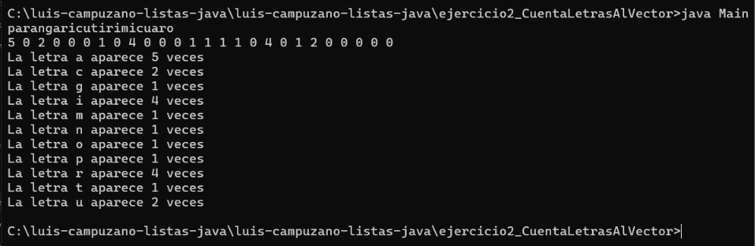

### 2. Caso límite
Se utiliza una sola letra `a` para comprobar el funcionamiento con una entrada pequeña.

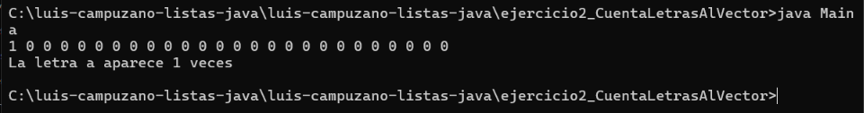

### 3. Caso grande
Se utiliza una cadena de 100 letras `a` para comprobar el conteo con una entrada más larga.

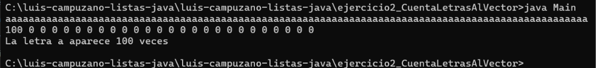

### 4. Resultado de omegaUp
Se muestra el resultado obtenido al enviar la solución a omegaUp.

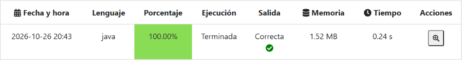

## Conclusiones
Al realizar este ejercicio practiqué la implementación de una lista enlazada simple y el recorrido de sus nodos para contar las apariciones de las letras. Comprobé el funcionamiento de la solución mediante omegaUp y realicé pruebas con diferentes entradas.

# Ejercicio 4: Inserción en Lista Enlazada

## Descripción
Este ejercicio consiste en implementar una lista enlazada simple en Java. El programa inserta un nodo con el valor `-1` antes de cada número impar que se encuentra en la lista y muestra la cantidad de nodos insertados junto con la lista actualizada.

## Archivos del programa
- `Main.java`: lee los números y muestra los resultados.
- `Nodo.java`: representa cada nodo de la lista.
- `ListaSimple.java`: implementa la lista enlazada y la inserción de nodos.

## Tipo de lista utilizada
Se utiliza una lista enlazada simple propia, implementada mediante las clases `Nodo` y `ListaSimple`. No se utilizan `LinkedList`, `ArrayList` ni `Vector` como estructura principal.

## Cómo compilar y ejecutar
Desde la carpeta del ejercicio 4, ejecutar:

cmd
javac Main.java Nodo.java ListaSimple.java
java Main

Después, escribir los números uno por línea. Para finalizar la entrada en la terminal de Windows, presionar `Ctrl + Z` y después `Enter`.

## Pruebas del ejercicio 4

### 1. Caso normal
Se utilizan los números `1`, `2` y `3` para comprobar que se inserte `-1` antes de cada número impar.

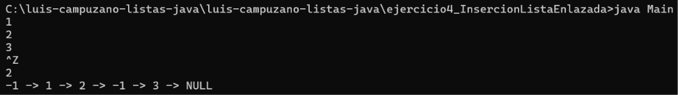

### 2. Caso límite
Se utiliza únicamente el número `2` para comprobar que no se inserten nodos adicionales cuando el número es par.

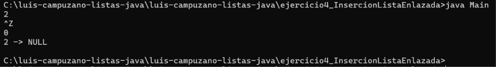

### 3. Caso con varios números
Se utilizan los números del `1` al `10` para comprobar la inserción antes de cada número impar.

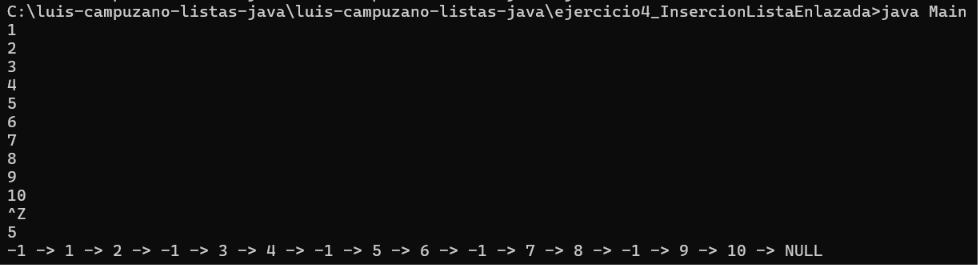

### 4. Resultado de omegaUp
Se muestra la captura del resultado obtenido al enviar la solución del ejercicio a omegaUp.

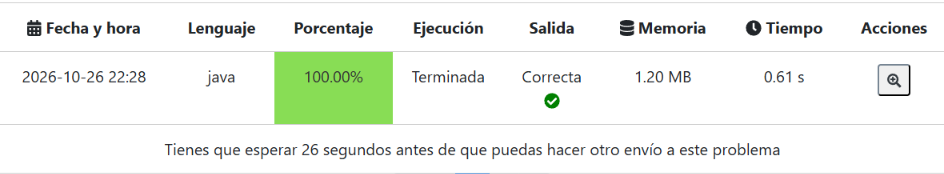

## Conclusión
Al realizar este ejercicio practiqué cómo implementar una lista enlazada simple, recorrer sus nodos e insertar nuevos elementos antes de los números impares. También comprobé el funcionamiento del programa con diferentes entradas y envié la solución a omegaUp.

# Ejercicio 6: Cajas de dulces

## Descripción

En este ejercicio se necesita encontrar la mayor cantidad de dulces que se pueden obtener al elegir un número determinado de cajas consecutivas.

Para resolverlo, utilicé una lista enlazada simple donde se guardan las cantidades de dulces de cada caja. Después, el programa calcula la suma de las primeras cajas y va avanzando por la lista para encontrar la suma más grande.

## Archivos del programa

- `Main.java`: lee los datos y muestra el resultado.
- `Nodo.java`: representa cada caja dentro de la lista.
- `ListaSimple.java`: almacena las cajas y calcula la suma máxima.

## Ejemplo de ejecución

**Entrada:**

```text
10 4
3 9 9 1 9 10 8 7 2 16
```

**Salida esperada:**

```text
34
```

## Evidencias de las pruebas

### 1. Prueba normal

Se utiliza el ejemplo principal del problema para comprobar que el programa encuentre la suma máxima de cajas consecutivas.

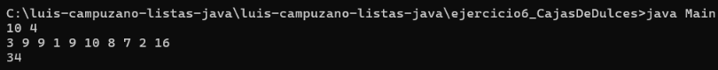

### 2. Prueba límite

Se prueba con cinco cajas y se seleccionan dos consecutivas.

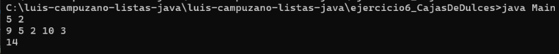

### 3. Prueba con valores iguales

Se comprueba el funcionamiento con seis cajas que contienen cinco dulces cada una, seleccionando tres consecutivas.

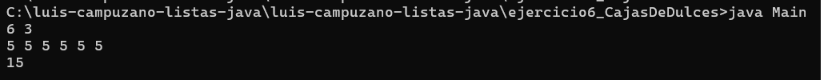

### 4. Veredicto de omegaUp

Se muestra la captura del resultado obtenido al enviar la solución a omegaUp.

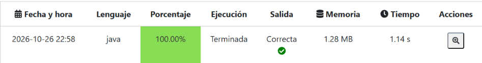

## Conclusión

Con este ejercicio practiqué el uso de listas enlazadas simples en Java. También aprendí a recorrer una lista para calcular la suma máxima de varias cajas consecutivas y comprobé el funcionamiento del programa mediante diferentes pruebas y su envío a omegaUp.

# Ejercicio 8: Derdenio y sus Estructuras de Datos

## Descripción

El objetivo de este ejercicio es combinar dos listas de números enteros que están ordenadas de menor a mayor y mostrar todos sus elementos en una sola lista ordenada de mayor a menor.

Para resolverlo, se recorren las dos listas desde sus valores más grandes y se compara cuál es mayor. El número seleccionado se agrega al resultado hasta combinar todos los elementos.

## Archivos del programa

- `Main.java`: lee los datos y muestra el resultado.
- `Nodo.java`: representa cada nodo que almacena un número.
- `ListaSimple.java`: implementa la lista enlazada y combina los números de mayor a menor.

## Ejemplo de ejecución

**Entrada:**

text
5
1 7 9 12 23
2 3 8 14 24
```

**Salida esperada:**

text
24 23 14 12 9 8 7 3 2 1

## Evidencias de las pruebas

### 1. Prueba normal

Se comprueba el ejemplo del problema y que las dos listas se combinen en orden descendente.


### 2. Prueba con números iguales

Se comprueba que el programa conserve los valores repetidos al combinar ambas listas.


### 3. Prueba con números negativos

Se verifica que los números negativos y el cero se muestren correctamente de mayor a menor.


### 4. Prueba con valores diferentes

Se utilizan dos listas con valores diferentes para comprobar que todos los números se combinen en el orden correcto.


### 5. Veredicto de omegaUp

Se muestra la evidencia del envío de la solución al juez en línea omegaUp.


## Conclusión

Con este ejercicio practiqué la combinación de dos listas ordenadas y el uso de listas enlazadas en Java. También aprendí a comparar los elementos para obtener una lista ordenada de mayor a menor y comprobé el funcionamiento del programa con diferentes pruebas.
